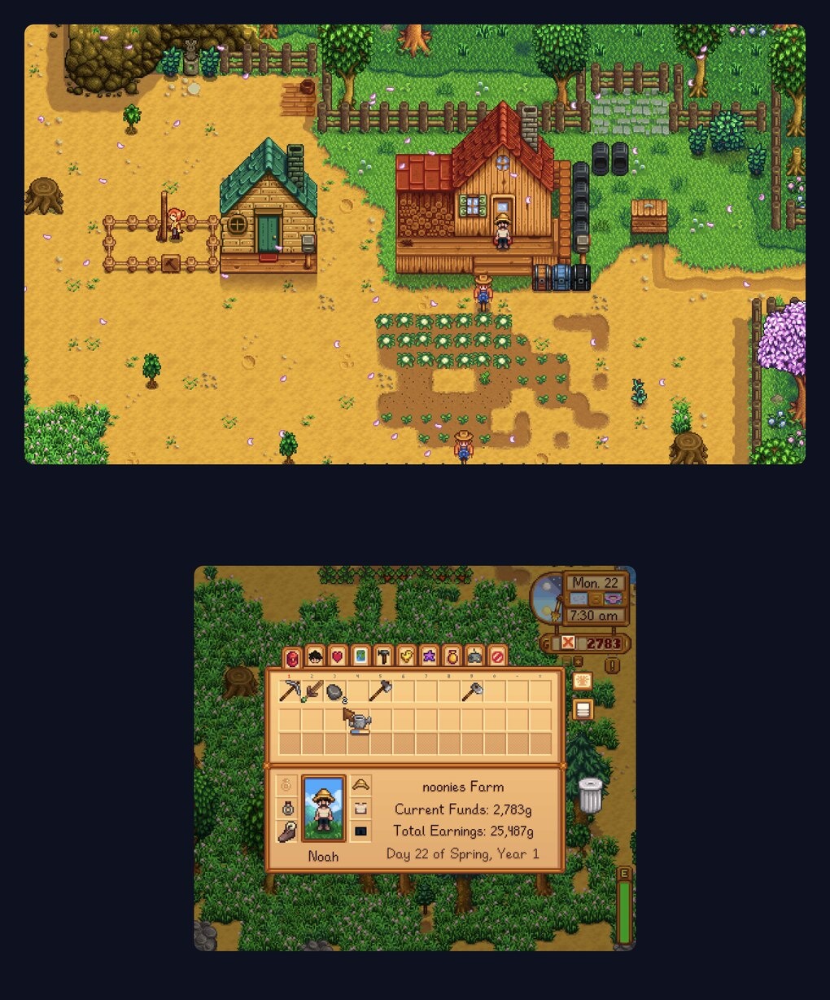

<div align="center">


**Your PC games, across both screens of your dual-screen Android handheld.**

A fork of [GameNative](https://github.com/utkarshdalal/GameNative) that makes the second screen part of the game.
The world plays on the top screen. The HUD, inventory, map and dialogue live on the bottom screen, and you use them
with your fingers.


<sub>Stardew Valley on an AYN Thor. Both screens are captured on the device and assembled at their physical scale,
hinge included, so the farm lines up across the gap exactly as it does in your hands.</sub>

</div>

## What it is

[GameNative](https://github.com/utkarshdalal/GameNative) runs the Windows games you own on Steam, Epic, GOG and Amazon
directly on Android, using Wine, Box64 and DXVK. It uses one screen.

GameNative Duo adds what a dual-screen handheld needs:

- **One game across two screens.** The game renders a single tall picture. The top part goes to the top screen and the
  rest to the bottom screen, straight from the same GPU frame with no copies. A one-time calibration accounts for the
  hinge and for the different pixel density of each panel, so the picture reads as one.
- **Interface on the bottom screen.** Small per-game mods move the HUD and menus off the game view. The top screen shows
  only the game. Crosshairs and other things you aim with stay on top automatically.
- **A real touchscreen.** The bottom screen behaves like a touchscreen built into the game: no cursor, taps land under
  your finger, and drag and drop works. The game never switches its button prompts to keyboard and mouse.
- **A layout you control.** Every piece of the interface can be moved, resized, hidden or sent to the top screen, live,
  while you play.

GameNative Duo installs next to official GameNative under its own app id (`app.gamenative.duo`), so you can keep both.

## A closer look

<table>
<tr>
<td width="50%" align="center"></td>
<td width="50%" align="center"></td>
</tr>
<tr>
<td valign="top"><b>Dialogue and events</b><br>Conversations and choices appear on the bottom screen, and you answer
them with a tap. The scene stays uncovered on top.</td>
<td valign="top"><b>Inventory</b><br>Menus are laid out for the bottom screen's own size and resolution, so nothing is
cut off and nothing covers the game.</td>
</tr>
<tr>
<td width="50%" align="center"></td>
<td width="50%" align="center"></td>
</tr>
<tr>
<td valign="top"><b>Drag and drop</b><br>Pick an item up with your finger, carry it and drop it in another slot. Touches
go into the game directly and never move the system mouse.</td>
<td valign="top"><b>Map and menus</b><br>Every menu the game opens goes to the bottom screen: the map, the journal, shops
and settings.</td>
</tr>
<tr>
<td width="50%" align="center"></td>
<td width="50%" align="center"></td>
</tr>
<tr>
<td valign="top"><b>Layout editor</b><br>Hold two fingers on the bottom screen and choose Edit UI layout. Tap an element,
then send it to the top or bottom screen, hide it, drag it or resize it.</td>
<td valign="top"><b>Your layout</b><br>Here the clock and money moved to the top screen. Changes apply instantly and are
saved per game, as fractions of the screen, so a layout fits any device with the same screen shapes.</td>
</tr>
</table>

## Features

### Two screens, one picture
The game draws one frame for both screens and each screen shows its part of it. The split costs no extra rendering and
no frame copies. Calibration (hinge gap, pixel density, horizontal offset) is set once per device from the two-finger
menu and stays live, so you can line the screens up with a game running.

### Native touch
Bottom-screen touches are delivered to the game's own interface system: Unity's UI events, or the game's mouse state in
Stardew Valley without moving the real pointer. Taps, holds, drags and drops behave as the game expects, and a tap is
never mistaken for a gameplay click.

### Layout editor
The editor lists every interface element the game reports, outlines them on the bottom screen and shows a map of the top
screen for elements placed there. Select, move, pinch to resize, hide, reset one element or all of them. Layouts are
plain JSON and use the same format as community presets.

### Region view, for any game
Games without a dual-screen mod can still use the bottom screen. Region view leaves the game unchanged on the top screen
and shows a live, magnified part of the same frame on the bottom screen, such as a minimap. Taps on the bottom screen
click the game at the matching spot. It costs almost nothing: the bottom screen is drawn from the frame already on the
GPU.

### Community packages
A Community button on each game page lists shared layouts, recommended settings and dual-screen mods for that game.
Packages come from a signed index on GitHub
([GameNativeDuo-community](https://github.com/nono5822/GameNativeDuo-community)). Layouts and settings apply in one tap.
Code mods install only after a consent screen that explains what they change, and removing one restores the game
exactly. Share your own layout from the same screen, and rate packages through GitHub Discussions.

### One-tap mods
Games with a bundled dual-screen mod get a Dual screen switch next to Play. It installs the mod and its loader, sets the
screen size and restores everything when switched off. After an app update, installed mods are refreshed automatically.

## Games

| Game | Engine | Support | Status |
|---|---|---|---|
| Stardew Valley | MonoGame (SMAPI) | Bundled mod | World across both screens, full touch interface, layout editor |
| Slime Rancher | Unity (BepInEx) | Bundled mod | HUD below, crosshair on top, native touch, layout editor |
| Subnautica | Unity (BepInEx) | Bundled mod | HUD and menus below, prompts and reticle on top |
| Balatro | LOVE (Lovely) | Bundled mod | Works |
| Dead Cells | HashLink | Region view | Minimap on the bottom screen, no mod needed |
| Hollow Knight, Silksong | Unity (BepInEx) | Community mod | Experimental, built from the game files, not yet tested on hardware |
| Risk of Rain 2 | Unity (BepInEx) | Community mod | Experimental, not yet tested on hardware |
| The Binding of Isaac | Custom | Region view | Experimental minimap preset |

The Unity adapter is generic. Most Unity games that use the Mono backend and Unity's standard UI can be added with a
single catalog entry, with per-game adjustments only where a game needs them. The list of games to support next is
ranked from GameNative's own play data for the AYN Thor ([`duo/futuregames.md`](https://github.com/nono5822/GameNativeDuo/blob/duo/slime-rancher/duo/futuregames.md)).

## Devices

| Device | Status |
|---|---|
| AYN Thor | Supported. Top screen 1920x1080, bottom screen 1240x1080, calibration built in |
| AYANEO Pocket DS, Retroid Dual Screen and others | Planned. Device profiles name screens "top" and "bottom" independently of how Android numbers its displays |

## Getting started

1. Install the APK. It sits next to official GameNative. Sign in as you would in GameNative.
2. Open a game with dual-screen support (the Dual screen tab lists them) and turn on its Dual screen switch, or open
   Community to apply a shared package.
3. Press Play. Unity games need their in-game resolution set to the tall window once (1920x2160 on the Thor).
4. In game, hold two fingers on the bottom screen to open the menu: Edit UI layout, Line up screens, or Choose bottom
   view for region view.

Every GameNative Duo option lives in the GameNative Duo tab of the container settings: screen split, split mode, split
resolution, native touch and the bottom-screen panel.

## Performance

Emulated games are limited by the CPU, and a handheld runs on a small battery. Every part of GameNative Duo is built
around that.

- Frames are never copied by the CPU. Both screens are drawn from the same GPU frame.
- Nothing polls. The app and the game mods talk over a local bridge that sends a few bytes per touch and is idle
  otherwise.
- Per-frame work is limited to the interface elements you changed. Measured in Slime Rancher on the Thor, the Unity
  adapter costs about 0.1 ms per frame, under half a percent of the frame time.
- Region view in Dead Cells kept the GPU around 12% busy.
- A split resolution setting (100, 75 or 50%) lowers the cost of the tall window on demanding games.

## For developers: a dual-screen devkit

The goal is that anyone can make a game dual-screen, whatever its engine, without changing the app. An in-game mod, the
engine adapter, and the app share a small, engine-neutral contract:

- **`layout.json`** describes where each screen sits inside the game window.
- **`ui.json`** holds the user's layout: for each element, its screen, scale and offset. Presets use the same format.
- **A local bridge** (UDP on 127.0.0.1, 16-byte touch packets) carries native touch, live layout updates and the
  element list for the editor.

Implement those three things for an engine and the editor, storage, touch and community presets work unchanged. The
specification is [`duo/docs/engine-adapter-contract.md`](https://github.com/nono5822/GameNativeDuo/blob/duo/slime-rancher/duo/docs/engine-adapter-contract.md).
The Unity adapter ([`duo/mods-src/unity`](https://github.com/nono5822/GameNativeDuo/tree/duo/slime-rancher/duo/mods-src/unity))
is the reference implementation, and the Stardew Valley adapter
([`duo/mods-src/stardew`](https://github.com/nono5822/GameNativeDuo/tree/duo/slime-rancher/duo/mods-src/stardew)) is a
second, complete example for a non-Unity engine.

### Roadmap
- More engine adapters: Godot (Slay the Spire 2, Brotato), Unreal (UMG), Ren'Py, RPG Maker, Unity UI Toolkit.
- Top-screen masks for region view, so an element shown below can be hidden above.
- An MCP server so AI agents can help build and test dual-screen mods: inspect the interface, move elements and capture
  both screens.
- Bottom-screen panels and window routing.

### Building
```bash
./gradlew :app:assembleModernDebug     # APK in app/build/outputs/apk/modern/debug/
```
The newest work is on the `devkit` branch and the `duo/*` feature branches. Architecture, conventions and debugging
notes are in [`CLAUDE.md`](https://github.com/nono5822/GameNativeDuo/blob/duo/slime-rancher/CLAUDE.md) and
[`duo/notes/`](https://github.com/nono5822/GameNativeDuo/tree/duo/slime-rancher/duo/notes).

## Staying close to GameNative

This fork follows upstream closely. New code lives in its own package (`app.gamenative.duo`), and upstream files are
only touched with small, documented hooks, so GameNative's improvements arrive here quickly. Fixes that help upstream
are offered back.

## Credits and licence

- [GameNative](https://github.com/utkarshdalal/GameNative) and everyone behind it. This fork is built entirely on their
  work. Please support them.
- Mod loaders bundled unmodified, with their licences: [BepInEx](https://github.com/BepInEx/BepInEx) (MIT),
  [SMAPI](https://github.com/Pathoschild/SMAPI) (LGPL-3.0) and
  [Lovely](https://github.com/ethangreen-dev/lovely-injector) (MIT).
- Licensed under the GPL-3.0, like GameNative.

Mods only change games you own. Nothing in this project bypasses or weakens DRM.
