<div align="center">

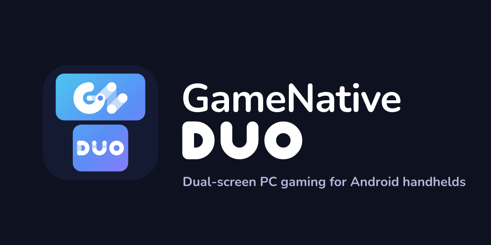

**PC games across both screens of your dual-screen Android handheld.**

A fork of [GameNative](https://github.com/utkarshdalal/GameNative) that makes the second screen part of the game.
It is a hub for dual-screen PC mods. Instead of being limited to a companion app, GameNative Duo brings per-engine
solutions to each game, with plenty of tools for developers. It can render a game's interface on the bottom screen,
extend the game view onto the bottom screen as one continuous picture, resize interface elements, add widgets, make
bottom-screen elements touchable, and much more.

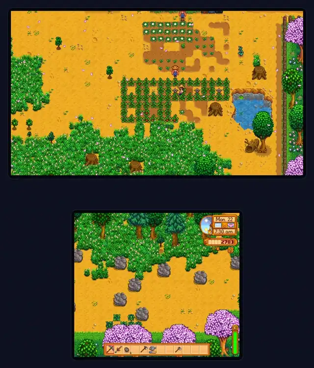

<sub>Recorded on an AYN Thor. Both screens are captured on the device and assembled at their physical scale, hinge
included, so the farm lines up across the gap exactly as it does in your hands.</sub>

</div>

## What it is

### The goal
Dual-screen Android handhelds like the AYN Thor were built with DS emulation in mind. Play a PC game on one through
[GameNative](https://github.com/utkarshdalal/GameNative), which runs the Windows games you own on Steam, Epic, GOG and
Amazon with Wine, Box64 and DXVK, and the second screen sits there doing nothing. PC games were never designed for two
screens, and no single trick fixes them all: each game draws its HUD, menus and map its own way.

GameNative Duo's goal is to make the second screen a real part of the PC games you play on a dual-screen handheld, the
way it was on the DS and 3DS, and to make that possible for any game, built by anyone who wants to.

### A hub, in three layers
1. **The app** does the work every game shares. It splits the game's picture across both screens straight from the
   GPU, turns the bottom screen into a touchscreen the game understands, lines the screens up across the hinge, and
   provides the layout editor (on the device or from a PC), widgets, save backups and a clean undo.
2. **Mods** teach a game, or a whole engine, to use two screens. They talk to the app through a small, open contract,
   so one adapter can cover many games: the Unity adapter, for example, works with most Unity games through a short
   profile instead of new code.
3. **The community** shares mods, layouts and settings through a signed index. Installing one is a switch next to Play,
   and switching it off puts the game back exactly as it was.

### What a mod can do
- **Move the interface off the game.** HUD, menus, inventory and dialogue go to the bottom screen, and the top screen
  shows only the game. Things you aim with stay on top.
- **Make one picture out of two screens.** The world continues from the top screen onto the bottom one, aligned across
  the hinge. 
- **Add what the game never had.** A live map that follows you, or a companion page fed with the game's own state.
- **Make it touchable.** Taps, drags and drops go straight into the game's own interface, with no cursor, and the game
  keeps its controller prompts. For an example, the GameNative Duo Stardew Valley mod add drag and drop functionality to the bottom screen for the inventory menu.  
- **Leave the final say to the player.** Every element can be moved, resized, hidden or sent to the other screen, live,
  and the resulting preset can be shared with others easily.

Games without a mod still get something useful on the bottom screen: a live, magnified part of the picture (a minimap,
say) or a companion with notes, checklists and timers.

### Who it is for
- **Players**: turn on Dual screen and play. Tune the layout if you want to, or use one someone else shared.
- **Modders**: SDKs for C#, Lua and C, a simulator that runs your mod on a PC without a handheld, templates, and a
  conformance check. One adapter can bring a whole engine's worth of games to two screens.

GameNative Duo installs next to official GameNative under its own app id (`app.gamenative.duo`), so you can keep both.

## Balatro on two screens

The table stays on the top screen: the score, the blind, your jokers and the hand you play. Everything you touch moves
to the bottom screen: your hand at full width, Play, Sort and Discard under your thumbs, the hand you are building with
its chips and mult, your consumables, the shop, the blind select, the cash out, booster packs and the menus. Cards fly
between the screens as they would across one table. Play by touch or with the controller, which moves freely across
both screens.

<table>
<tr>
<td width="50%" align="center">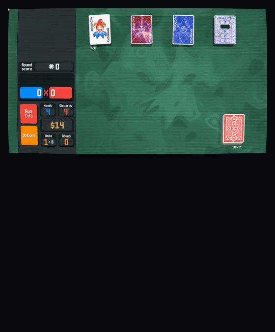</td>
<td width="50%" align="center">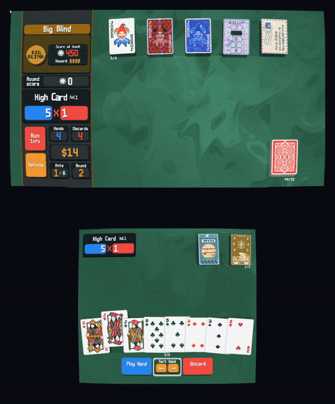</td>
</tr>
<tr>
<td valign="top"><b>Dealt across the hinge</b><br>Pick a blind below and the cards travel from the deck on the top
screen into your hand.</td>
<td valign="top"><b>Choose below, score above</b><br>The hand you are building is named as you pick it. Played cards
fly up to the table, where your jokers trigger.</td>
</tr>
<tr>
<td width="50%" align="center">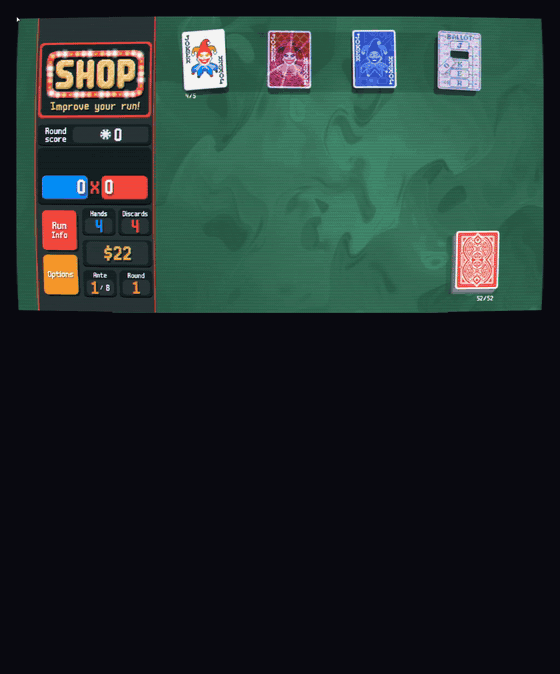</td>
<td width="50%" align="center">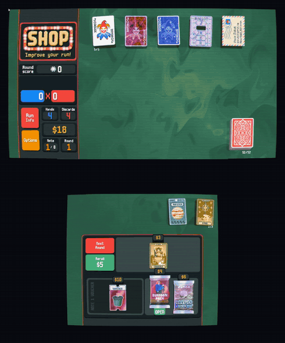</td>
</tr>
<tr>
<td valign="top"><b>The shop under your thumbs</b><br>A joker you buy takes its place on the top screen.</td>
<td valign="top"><b>Booster packs</b><br>Packs open on the bottom screen, with your hand dealt above the cards when a
tarot or spectral card needs targets.</td>
</tr>
</table>

<table>
<tr>
<td width="33%" align="center">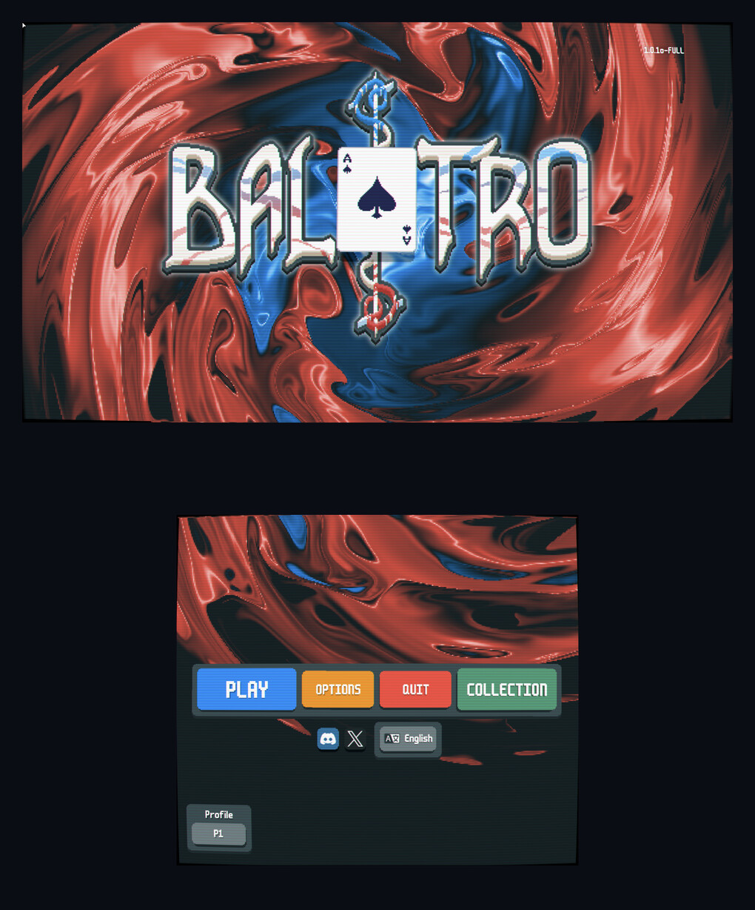</td>
<td width="33%" align="center">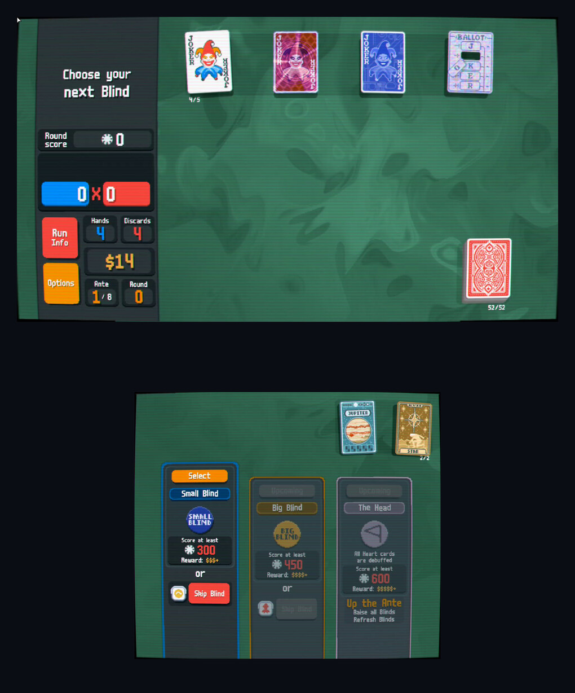</td>
<td width="33%" align="center"></td>
</tr>
<tr>
<td width="33%" align="center">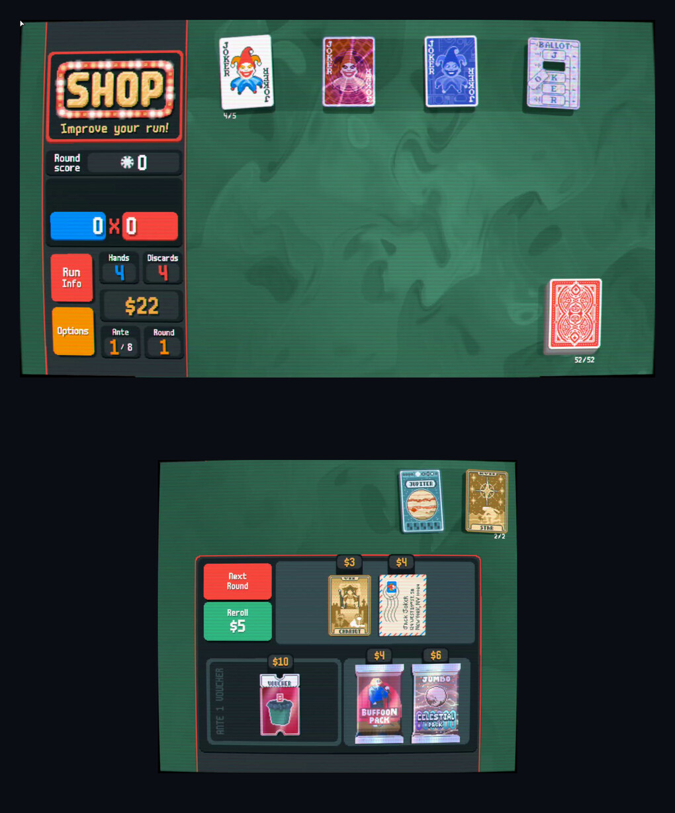</td>
<td width="33%" align="center">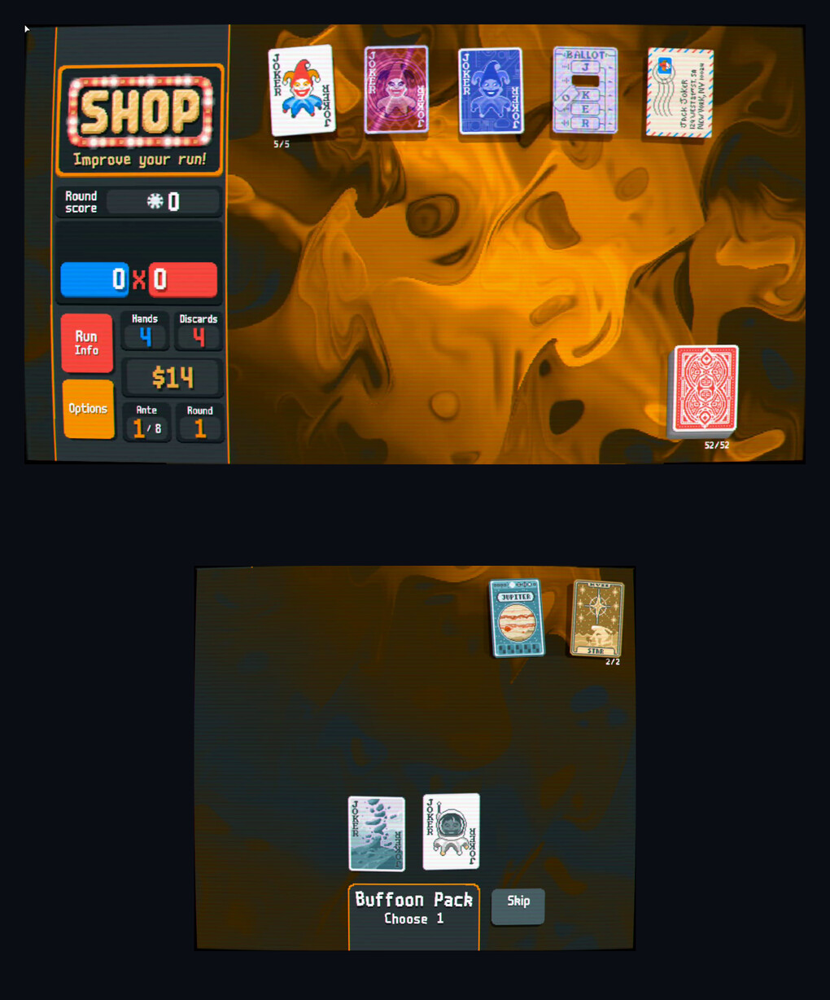</td>
<td width="33%" align="center">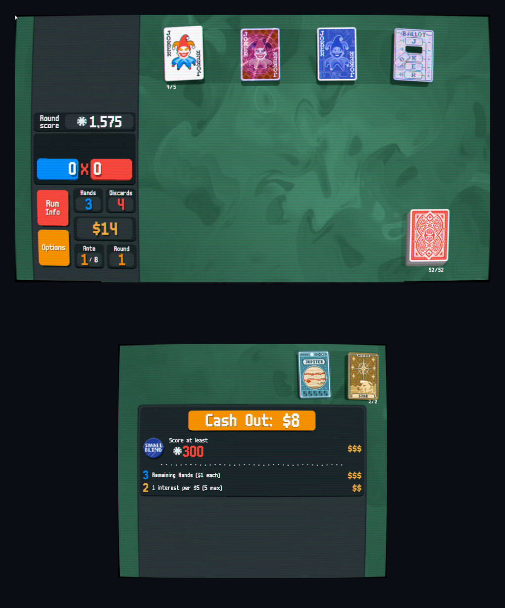</td>
</tr>
</table>

Built for long runs. Late game tables were tested with nine jokers, full consumable slots, an eleven card hand, every
mega pack, a four slot shop, boss blinds and controller only play. The mod is one render pass in one window, with no
second draw and no frame read back to the CPU, so it costs a few microseconds per frame. Balatro runs at a 75% split
resolution by default, which keeps a busy late game table near 60 fps on the Thor.

## Hollow Knight with a live map

<table>
<tr>
<td width="50%" align="center">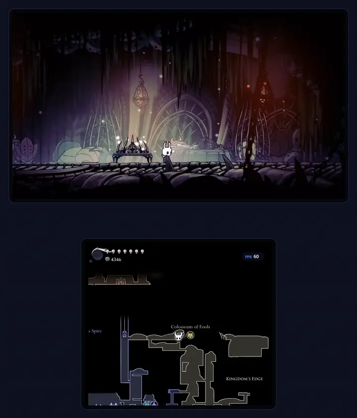</td>
<td width="50%" align="center">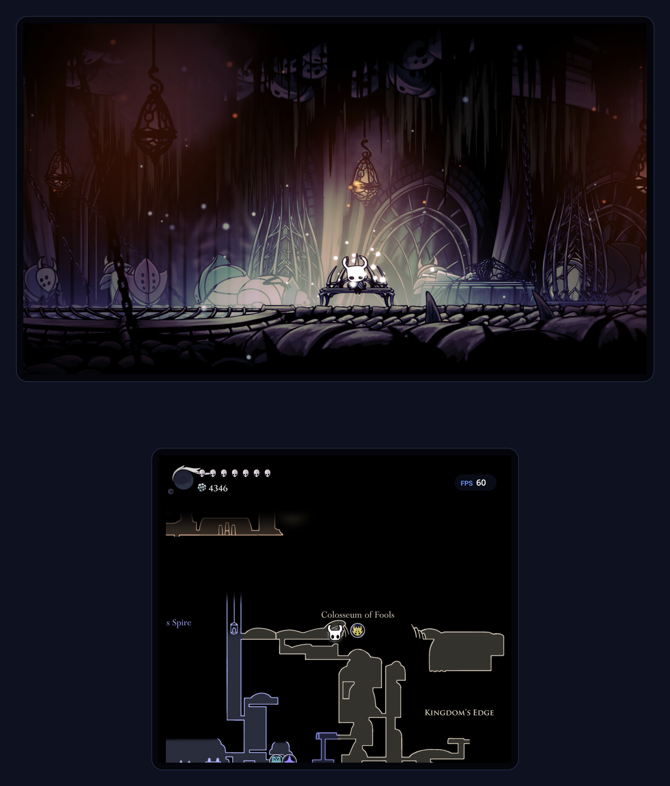</td>
</tr>
<tr>
<td valign="top"><b>A map that follows you</b><br>Knight, area and kingdom zoom, switched with the map button.</td>
<td valign="top"><b>Game on top, everything else below</b><br>Masks, soul and geo sit above the live map.</td>
</tr>
</table>

The kingdom stays on the top screen, and the bottom screen shows the game's own map, live, following the Knight as you
explore. Drag to pan, pinch or double-tap to zoom, and press the map button to switch between the Knight, the area and
the whole kingdom. The map dims under menus and dialogue instead of disappearing, and the inventory and pause menu open
below. Everything about the map (size, position, start zoom, how it behaves under menus, when the Knight icon shows) is
a setting in the layout editor, like any other element. It costs about 0.12 ms per frame on the Thor.

## Features

### Two screens, one picture
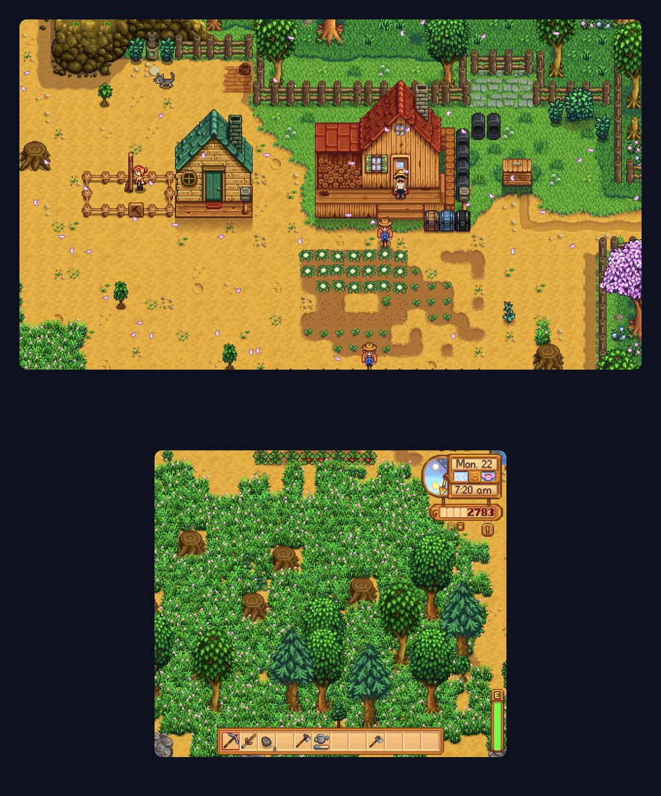

The game draws one frame for both screens and each screen shows its part of it. The split costs no extra rendering and
no frame copies. Calibration (hinge gap, pixel density, horizontal offset) is set once per device from the two-finger
menu and stays live, so you can line the screens up with a game running.

The top screen keeps the full 1920x1080 view of the world with nothing drawn over it. The bottom screen shows the world
continuing below, with the interface on top of it.
<br clear="right">

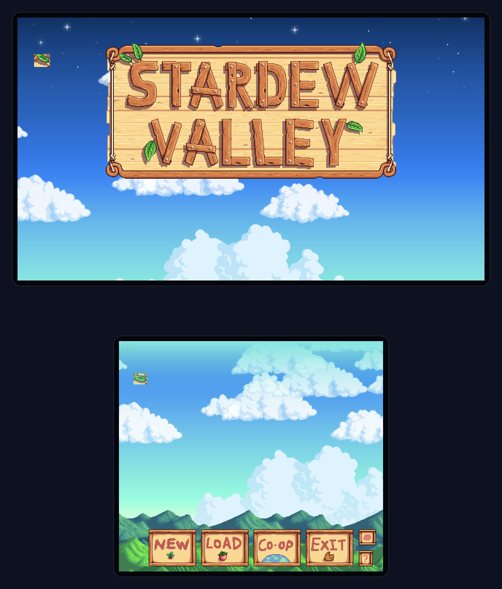

### Native touch
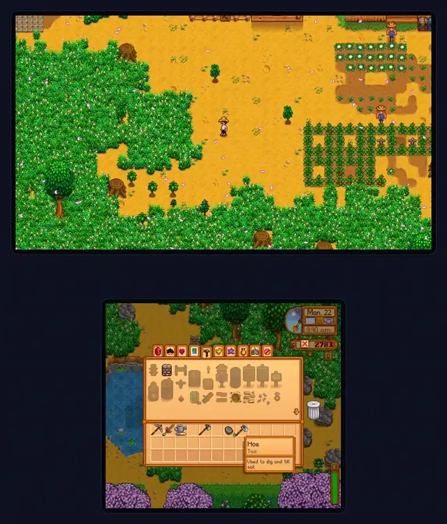

Bottom-screen touches are delivered to the game's own interface system: Unity's UI events, or the game's mouse state in
Stardew Valley without moving the real pointer. Taps, holds, drags and drops behave as the game expects, and a tap is
never mistaken for a gameplay click.

Here the inventory is open on the bottom screen while the farm stays visible above. Items are picked up and dropped
with a finger, and the game shows its own tooltips, with no cursor on screen.
<br clear="right">

### Layout editor
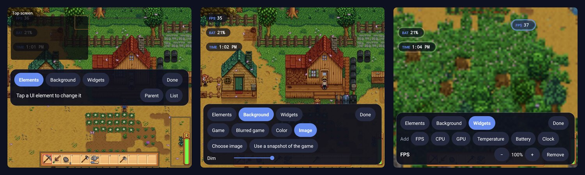

The editor opens on the bottom screen over the running game and has three tabs.

- **Elements** lists every interface element the game reports, outlines them on the bottom screen and shows a map of
  the top screen for elements placed there. Select, move, pinch to resize, hide, reset one element or all of them.
- **Background** chooses what sits behind the interface on the bottom screen (see below).
- **Widgets** adds live readouts and places them with a finger.

Everything applies within a frame and is saved per game. Layouts are plain JSON and use the same format as community
presets, so a shared layout carries its background and widgets too.

Each mod declares what can be edited, so the editor only offers what really works for that game, and says why when
something is off. Before you install a mod, its card already shows **Full** or **Partial** editing (or **Regions** for
region view). A mod can also add elements with their own settings, like Hollow Knight's live map.

<table>
<tr>
<td width="50%" align="center"></td>
<td width="50%" align="center">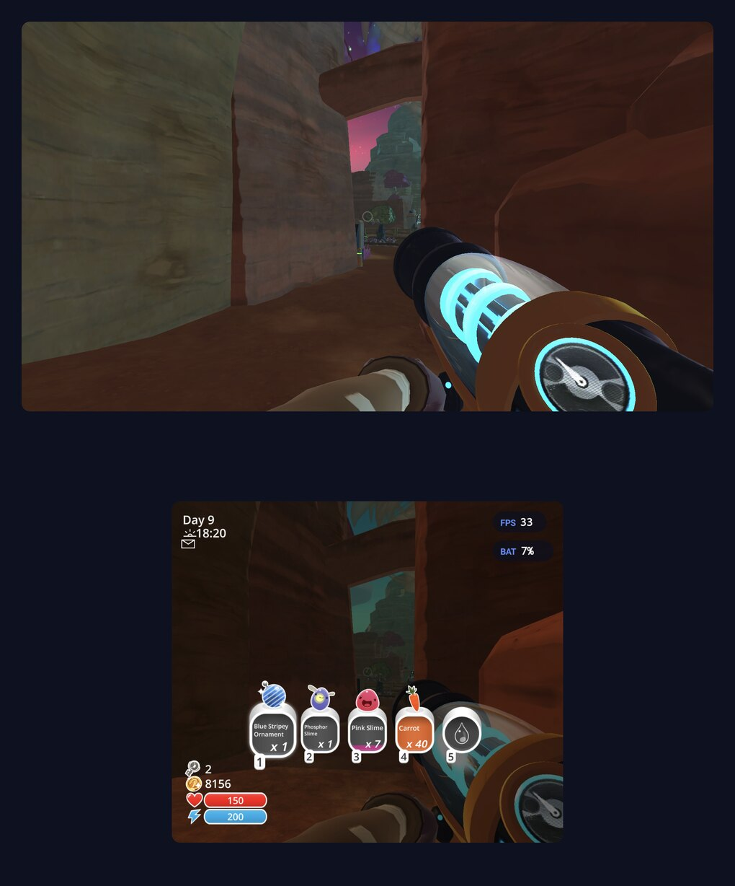</td>
</tr>
<tr>
<td valign="top"><b>Moving the interface</b><br>Slime Rancher's ammo hotbar selected as one group, dragged up and
enlarged in a few taps while the game keeps running.</td>
<td valign="top"><b>The result</b><br>The hotbar at the centre where the thumb reaches it, day and time top left,
health, energy, keys and money bottom left, FPS and battery top right, over a dimmed still of the game.</td>
</tr>
</table>

### Bottom screen background and widgets
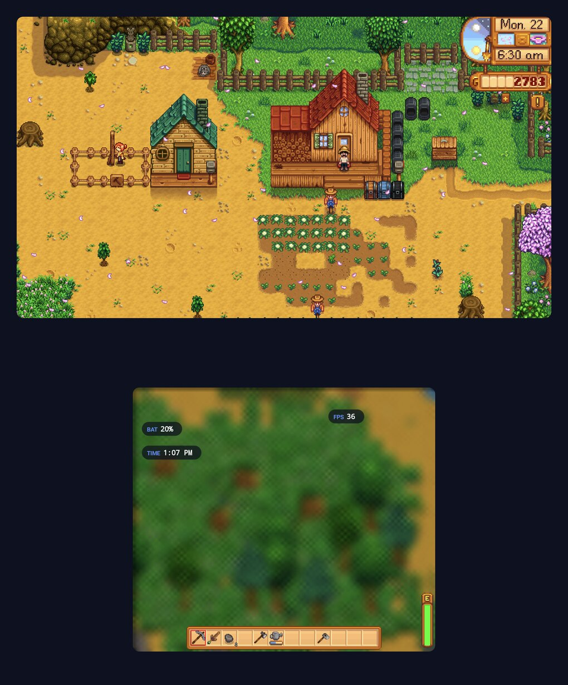

- **Game**: the world continues from the top screen onto the bottom one, aligned across the hinge.
- **Blurred game**: the same world, softly blurred, so the interface stands out.
- **Color**: a solid color from a palette. It also saves the game the work of drawing the lower part of the world.
- **Image**: any picture from your gallery, or a still capture of the top screen in one tap.

A dim slider darkens the game, blur and image backgrounds. The game's mod draws the background on the GPU, and the
editor only offers what that game's mod supports (Stardew Valley has all four, Unity games have color and image).

Widgets show FPS, CPU, GPU, temperature, battery or the time. They read what GameNative already measures for the
session, refresh once a second and cost nothing when none are placed.
<br clear="right">

### Edit from a PC
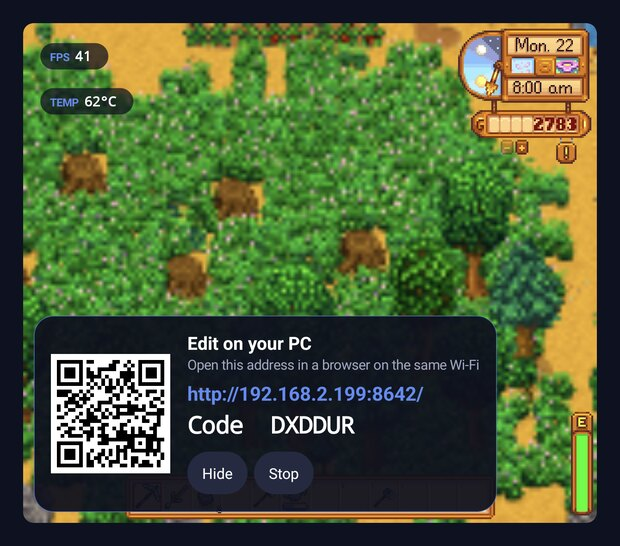

Choose Edit on PC and the device serves a web editor on your Wi-Fi. Open the address on a PC (or scan the QR code with
a tablet) and enter the six-letter code shown on the bottom screen. The page shows both screens with every interface
element outlined.

- Drag an element to move it, or drop it on the other screen to send it there. Scroll to resize.
- Search the element list, or use the keyboard: arrows move, plus and minus resize, T, B and H send an element to the
  top, the bottom or nowhere.
- Pick the background, upload an image from the PC, and place widgets.
- Share the layout with the community straight from the PC browser. Background images stay private.

The editor runs only while you have it open and stops with the game. After 20 wrong codes it shuts itself down.
<br clear="right">

### In GameNative's own menu
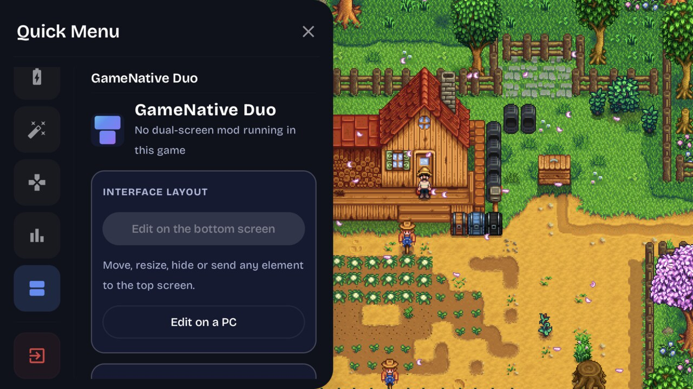

The menu GameNative opens with the Back button has a GameNative Duo tab: open the layout editor, start the PC editor,
change the background, switch widgets on and off, and line up the screens, without leaving the game.

### Region view, for any game
Games without a dual-screen mod can still use the bottom screen. Region view leaves the game unchanged on the top screen
and shows live, magnified parts of the same frame on the bottom screen, such as a minimap. Taps on the bottom screen
click the game at the matching spot. It costs almost nothing: the bottom screen is drawn from the frame already on the
GPU.

Regions are edited like any other element, on the device or from a PC: add several, pick what each one shows, and place
them on the bottom screen. **Move here** also hides the original on the top screen, so the minimap really moves instead
of showing twice.

### Companions
A companion is a small app for the bottom screen, made of pages of cards: notes, checklists, timers, a value or progress
tracker, a list, a picture of a map or a guide. The general companion works with every game, no mod needed. When a game
has no split, the companion is the bottom screen. During a split or region view, open it from the two-finger menu.
Companions are described in a JSON file, with no code, so anyone can write one for their game
([`duo/docs/companions.md`](https://github.com/nono5822/GameNativeDuo/blob/devkit/duo/docs/companions.md)).

### One control next to Play
Every game with dual-screen support gets a Dual screen control next to Play. The switch turns the mod on and off. The
arrow opens the mod explorer, which lists the bundled mod and the community ones for that game, with their editing
level, so you can choose which one the switch applies. Turning a mod on installs it and its loader, sets the
screen size and the launch options it needs; turning it off restores everything. After an app update, installed mods
are refreshed automatically.

<table>
<tr>
<td width="50%" align="center">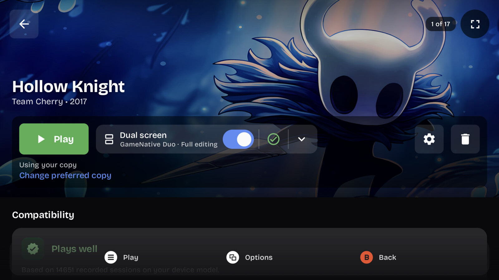</td>
<td width="50%" align="center">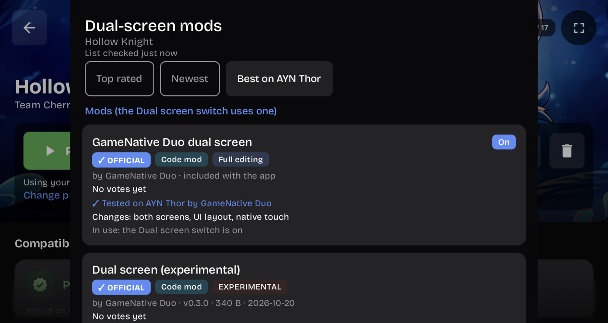</td>
</tr>
<tr>
<td valign="top"><b>The Dual screen control</b><br>On or off, which mod, and whether it is working, next to Play.</td>
<td valign="top"><b>The mod explorer</b><br>Bundled and community mods side by side, with their editing level.</td>
</tr>
</table>

If something is wrong (the mod did not start, the window has the wrong size, the game runs under a display server that
cannot split), the control says so and opens **Dual screen status**, with a one-tap fix for each problem, a check of the
mod's files and your save backups. The bottom screen also shows a card while the mod starts, and explains what happened
if it does not.

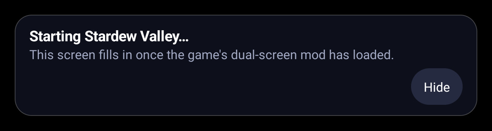

### Save backups
Your saves are zipped before every mod install, keeping the newest five per game. Restoring one backs up the current
saves first, so nothing is lost either way.

### Community packages
The mod explorer also lists shared layouts, recommended settings and dual-screen mods for each game. Packages
come from a signed index on GitHub
([GameNativeDuo-community](https://github.com/nono5822/GameNativeDuo-community)). Layouts and settings apply in one tap.
Share your own layout from the editor, and rate packages through GitHub Discussions.

Code mods are held to a higher bar. The community's build service builds them from their published source after a
maintainer has reviewed the code, the author signs them, and the app checks that signature. A mod can only use the
bridge features it declares, it installs only after a consent screen that explains all of this, and a mod withdrawn
from the index is removed from your device automatically, with your game restored. (The app side is done; it goes live
once the community repository publishes its first signed code mod.)

## Games

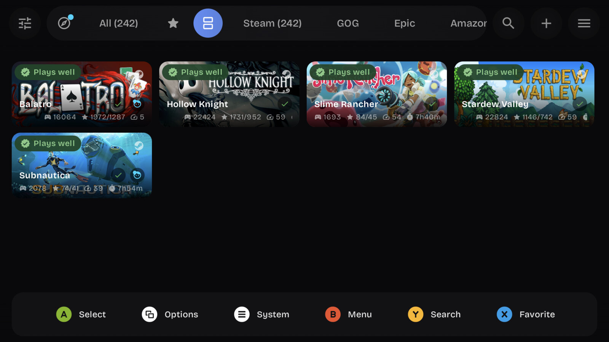

The library's Dual screen tab lists every game with a bundled dual-screen mod.

| Game | Engine | Support | Status |
|---|---|---|---|
| Stardew Valley | MonoGame (SMAPI) | Bundled mod | World across both screens, full touch interface, layout editor |
| Slime Rancher | Unity (BepInEx) | Bundled mod | HUD below, crosshair on top, native touch, layout editor |
| Subnautica | Unity (BepInEx) | Bundled mod | HUD and menus below, prompts and reticle on top |
| Balatro | LOVE (Lovely) | Bundled mod | Hand, shop, packs and menus below, table on top, native touch and controller |
| Hollow Knight | Unity (BepInEx) | Bundled mod | Live map on the bottom screen, HUD, inventory and menus below, layout editor |
| Dead Cells | HashLink | Region view | Minimap on the bottom screen, no mod needed |
| Silksong | Unity (BepInEx) | Community mod | Experimental, not yet tested on hardware |
| Risk of Rain 2 | Unity (BepInEx) | Community mod | Experimental, not yet tested on hardware |
| The Binding of Isaac | Custom | Region view | Experimental minimap preset |

The Unity adapter is generic. Most Unity games that use the Mono backend and Unity's standard UI can be added with a
single catalog entry, and per-game adjustments are a small `profile.json` (which cameras and canvases go where) instead
of code. Slime Rancher and Subnautica already work this way. Any other game gets the general companion. The list of games to support next is
ranked from GameNative's own play data for the AYN Thor ([`duo/futuregames.md`](https://github.com/nono5822/GameNativeDuo/blob/devkit/duo/futuregames.md)).

## Devices

| Device | Status |
|---|---|
| AYN Thor | Supported. Top screen 1920x1080, bottom screen 1240x1080, calibration built in |
| AYANEO Pocket DS, Retroid Dual Screen and others | Planned ([#9](https://github.com/nono5822/GameNativeDuo/issues/9)). Device profiles name screens "top" and "bottom" independently of how Android numbers its displays |

## Getting started

1. Install the APK. It sits next to official GameNative. Sign in as you would in GameNative.
2. Open a game with dual-screen support (the Dual screen tab lists them) and turn on the Dual screen switch next to
   Play. The arrow beside it opens the mod explorer if you want a community mod or layout instead.
3. Press Play. The bottom screen shows a card while the mod starts. The window size and Unity's launch resolution are
   set for you.
4. In game, hold two fingers on the bottom screen to open the menu: Companion, Edit UI layout (regions too, in region
   view), Edit on PC or Line up screens. The same options are in the GameNative Duo tab of GameNative's in-game menu
   (Back button).

Every GameNative Duo option lives in the GameNative Duo tab of the container settings: the bottom-screen panel, screen
split, native touch, split mode, split resolution, companion and developer mode.

## Performance

Emulated games are limited by the CPU, and a handheld runs on a small battery. Every part of GameNative Duo is built
around that.

- Frames are never copied by the CPU. Both screens are drawn from the same GPU frame.
- Nothing polls. The app and the game mods talk over a local bridge that sends a few bytes per touch and is idle
  otherwise.
- Per-frame work is limited to the interface elements you changed. Measured in Slime Rancher on the Thor, the Unity
  adapter costs about 0.1 ms per frame, under half a percent of the frame time.
- Region view in Dead Cells kept the GPU around 12% busy.
- Hollow Knight's live map costs about 0.12 ms per frame, and the game stays at 60 fps with it on.
- The Balatro mod draws both screens in one pass and never reads a frame back. Its own work is about 0.06 ms per
  frame. The cost that remains is presenting the tall frame, so Balatro defaults to the 75% split resolution.
- A split resolution setting (100, 75 or 50%) lowers the cost of the tall window on demanding games.
- Bottom screen backgrounds are drawn by the game on the GPU. The blur works on a target of a few thousand pixels, and
  a solid color skips drawing the lower part of the world.
- Widgets redraw once a second, and the PC editor copies a screen only when the page asks for it.

## For developers: a dual-screen devkit

The goal is that anyone can make a game dual-screen, whatever its engine, without changing the app. An in-game mod, the
engine adapter, and the app share a small, engine-neutral contract:

- **`layout.json`** describes where each screen sits inside the game window.
- **`ui.json`** holds the user's layout: for each element, its screen, scale and offset. Presets use the same format.
- **A local bridge** (UDP on 127.0.0.1, 16-byte touch packets) carries native touch, live layout updates and the
  element list for the editor. It also carries game state for companions, commands back to the game, log lines and
  haptics.

Implement those three things for an engine and the editor, storage, touch and community presets work unchanged. The
specification is [`duo/docs/engine-adapter-contract.md`](https://github.com/nono5822/GameNativeDuo/blob/devkit/duo/docs/engine-adapter-contract.md).
The Unity adapter ([`duo/mods-src/unity`](https://github.com/nono5822/GameNativeDuo/tree/devkit/duo/mods-src/unity))
is the reference implementation, and the Stardew Valley adapter
([`duo/mods-src/stardew`](https://github.com/nono5822/GameNativeDuo/tree/devkit/duo/mods-src/stardew)) is a
second, complete example for a non-Unity engine.

### Tools for modders
- **SDKs** ([`duo/sdk/`](https://github.com/nono5822/GameNativeDuo/tree/devkit/duo/sdk)) for C# (Unity, MonoGame and
  any .NET game), Lua (LÖVE) and C (a header-only library for native mods), with short examples. The bundled mods use
  them too.
- **The `duo` tool** ([`duo/tools/duo`](https://github.com/nono5822/GameNativeDuo/tree/devkit/duo/tools/duo)): start a
  mod from a template, build, test and pack it, and check it against the contract. Its simulator runs a mod on a PC with
  no handheld at all, and its web UI inspects elements, bridge traffic and logs, on the simulator or on a device
  ([`duo/docs/duo-api.md`](https://github.com/nono5822/GameNativeDuo/blob/devkit/duo/docs/duo-api.md)).
- **AI assistants**: `duo mcp` lets an AI agent inspect a running game's interface, move elements and capture both
  screens, and a Claude skill teaches it the contract.
- **A VS Code extension** that wraps the same tool.
- **Developer mode** in the app: an overlay on the bottom screen with the mod's engine, SDK version and capabilities,
  bridge traffic and its latest log lines, plus mods pushed from the PC (`duo dev --device`) that replace the installed
  files at the next start.
- **Game profiles** ([`duo/docs/game-profiles.md`](https://github.com/nono5822/GameNativeDuo/blob/devkit/duo/docs/game-profiles.md)):
  for many Unity games, a `profile.json` that says which cameras and canvases go where is the whole port.
- **A conformance check** ("Check" in the editor's element list) tries every feature a mod declares and reports what
  does not work.

### Roadmap
Planned work is tracked in the [issues](https://github.com/nono5822/GameNativeDuo/issues). The main items:
- Touch hotkeys: buttons on the bottom screen for keys, clicks and gamepad buttons, for any game
  ([#8](https://github.com/nono5822/GameNativeDuo/issues/8)).
- Choosing your device on first start, and per-device versions of mods and layouts
  ([#9](https://github.com/nono5822/GameNativeDuo/issues/9)).
- Widgets on the top screen and battery options for the bottom screen
  ([#10](https://github.com/nono5822/GameNativeDuo/issues/10)).
- More engine adapters: Godot (Slay the Spire 2, Brotato), Unreal (UMG), Ren'Py, RPG Maker, Unity UI Toolkit.
- Window routing: sending a game's extra windows to the bottom screen.

### Building
```bash
./gradlew :app:assembleModernDebug     # APK in app/build/outputs/apk/modern/debug/
```
How to report a bug, ask for a game or send a change: [`CONTRIBUTING.md`](CONTRIBUTING.md).
The newest work is on the `devkit` branch. Architecture, conventions and debugging notes are in [`CLAUDE.md`](https://github.com/nono5822/GameNativeDuo/blob/devkit/CLAUDE.md) and
[`duo/notes/`](https://github.com/nono5822/GameNativeDuo/tree/devkit/duo/notes).

## Staying close to GameNative

This fork follows upstream closely. New code lives in its own package (`app.gamenative.duo`), and upstream files are
only touched with small, documented hooks, so GameNative's improvements arrive here quickly. Fixes that help upstream
are offered back.

## How it's built

GameNative Duo is a one-person project, and I build it with AI coding tools. I'd rather say that plainly than leave
you to guess from the commit trailers.

- **I set the direction.** I choose what gets built, the architecture, and the rules the code follows: new code in its
  own package, one-line hooks into upstream files, no extra work on the CPU each frame. Those rules are written down
  in [`CLAUDE.md`](https://github.com/nono5822/GameNativeDuo/blob/devkit/CLAUDE.md), and planned work is in the [issues](https://github.com/nono5822/GameNativeDuo/issues).
- **Claude Code writes much of the code.** Commits it helped with carry a `Co-Authored-By: Claude` line.
- **Nothing counts until it works on the device.** Changes have to build and pass the unit tests, and I check them on
  an AYN Thor with real games, both screens, and frame rates and GPU logs when performance matters. Changes come in as
  pull requests that I review.
- **Some tasks run overnight.** A script in [`duo/agents/`](https://github.com/nono5822/GameNativeDuo/tree/devkit/duo/agents) takes issues one at a time,
  runs an agent against the Thor over adb, and leaves the work on its own branch for me to review in the morning. A
  local model on my PC reads the long logs, so the main model doesn't have to.
- **Most of the time goes into testing and debugging.** GPU hangs, a crash that only showed up after a clean build,
  game cameras fighting over the screen: each one was tracked down with kernel and system logs from the device and by
  switching features off one at a time. What was found is written up in [`duo/notes/`](https://github.com/nono5822/GameNativeDuo/tree/devkit/duo/notes).

## Credits and licence

- [GameNative](https://github.com/utkarshdalal/GameNative) and everyone behind it. This fork is built entirely on their
  work. Please support them.
- Mod loaders bundled unmodified, with their licences: [BepInEx](https://github.com/BepInEx/BepInEx) (MIT),
  [SMAPI](https://github.com/Pathoschild/SMAPI) (LGPL-3.0) and
  [Lovely](https://github.com/ethangreen-dev/lovely-injector) (MIT).
- [balatro-dualscreen](https://github.com/rosbean/balatro-dualscreen) by rosbean (GPL-3.0), the native Android dual
  screen Balatro that inspired the layout of the Balatro mod.
- Licensed under the GPL-3.0, like GameNative.

Mods only change games you own. Nothing in this project bypasses or weakens DRM.
